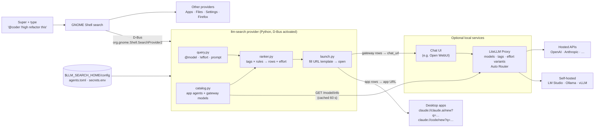

# Design

## Goals
- Prompt any LLM or agent from the GNOME Shell search bar, without changing normal search results.
- One extra search category, alongside the others (Files, Settings, Firefox, …).
- Any provider: desktop app agents through their links, and API models through a single gateway, so
  new models show up without any change to this project.
- Suggestions for each prompt, plus choosing a model and effort explicitly while typing.
- No shell patching (not an extension), no dependencies beyond the Python standard library and PyGObject.

## Architecture

## Components
| File | Role |
|---|---|
| `src/llm_search/provider.py` | Implements `SearchProvider2` on a `Gio.Application` (`IS_SERVICE`) that D-Bus starts on the first search and that exits after 60 s idle |
| `src/llm_search/query.py` | Splits `@model` and `!effort` tokens from the prompt |
| `src/llm_search/catalog.py` | Builds candidates from `[[app]]` entries and the gateway's `/model/info`, grouping effort variants by `model_info.base` |
| `src/llm_search/ranker.py` | Scores candidates (`priority` + matched rule weights), suggests and clamps effort, picks the rows |
| `src/llm_search/launch.py` | Fills URL templates, drops empty query parameters, opens the URL with `Gio.AppInfo.launch_default_for_uri` |
| `src/llm_search/config.py` | Loads `agents.toml` and `secrets.env` from `$LLM_SEARCH_HOME` |
| `bin/llm-search` | Installer and management CLI |
| `share/` | Search provider `.ini`, D-Bus `.service` and `.desktop` templates, icon |

## Search flow
1. GNOME Shell calls `GetInitialResultSet(terms)` as you type, then `GetSubsearchResultSet` as you keep typing.
2. The provider parses the terms, ranks the candidates, and returns result ids of the form
   `<candidate>|<model>|<effort>|<query key>` (e.g. `app:claude-code|||48726cc7f5c5`). The query key is a
   short hash of the query: GNOME Shell caches rows by id, so the id has to change when the query does.
3. `GetResultMetas` returns each row's title, description (prompt, effort, matched tags) and icon.
4. `ActivateResult(id, terms)` builds the URL from the id and the prompt in `terms`, then opens it.
   `LaunchSearch` (clicking the category icon) opens the top row.

## Why these choices
- **A search provider, not an extension.** `SearchProvider2` is a stable, documented D-Bus interface,
  the same one Files, Settings and Firefox use. Extensions patch GNOME Shell's internals and often
  break on major updates.
- **A session data dir for the `.ini`.** GNOME Shell reads `gnome-shell/search-providers/` only from
  system data dirs (`collectFromDatadirs(..., false)` in `remoteSearch.js`), not from `~/.local/share`.
  Rather than requiring root, the installer adds `$LLM_SEARCH_HOME/state/xdg` to the session's
  `XDG_DATA_DIRS` through `environment.d`. The D-Bus service and desktop entry can stay in
  `~/.local/share`, where per-user files are supported.
- **The category comes from a desktop entry.** GNOME takes the category's name and icon from the
  provider's `DesktopId`, and skips hidden entries. So the project ships a visible entry, which opens
  the chat UI when launched.
- **A gateway instead of one client per provider.** LiteLLM handles each provider's API, keys,
  fallbacks and routing. The provider only needs an OpenAI-style model list, so the gateway can be
  swapped for another one.
- **Effort as model variants.** Chat UIs can choose a model from a URL but not an effort setting. So
  each effort level is its own gateway model (`gpt@high`), grouped back into one row by `model_info.base`.
- **Fast local ranking.** GNOME searches on every keystroke, so ranking uses regex rules that take
  milliseconds. Asking an LLM classifier on every keystroke would be too slow and would cost money.
  The **Auto** row hands the choice to the gateway's router for an actual request.

## Limits
- Claude Desktop links take a prompt and folders, but no model or effort.
- GNOME shows about five rows per category.
- Ranking is keyword-based. Showing several suggestions, plus `@model`, makes up for its mistakes.
