# Design

## Goals
- Prompt any LLM or agent from the GNOME Shell search bar, without changing normal search results.
- One extra search category, alongside the others (Files, Settings, Firefox, …).
- Any provider: desktop app agents through their links, and API models through a single gateway, so
  new models show up without any change to this project.
- Suggestions for each prompt, plus choosing a model and effort explicitly while typing.
- No shell patching (not an extension). Fast and light: a Rust search provider that doesn't load GTK,
  and a GTK 4 / libadwaita prompt box.

## Architecture

```mermaid
flowchart LR
    U["Super + type<br/>'@coder !high refactor this'"] --> GS["GNOME Shell search"]
    GS --> N["Other providers<br/>Apps · Files · Settings · Firefox"]
    GS -->|"D-Bus<br/>org.gnome.Shell.SearchProvider2"| P

    subgraph P["llm-search search-provider (Rust, no GTK, D-Bus activated)"]
        direction TB
        Q["core::query<br/>@model · !effort · prompt"] --> RK["core::ranker<br/>tags × rules → rows + effort"]
        C["core::catalog<br/>app agents + gateway models"] --> RK
        RK --> L2["core::launch → platform::execute<br/>fill URL / command → open or run"]
    end

    CFG[("$LLM_SEARCH_HOME/config<br/>agents.toml · secrets.env")] --> P
    C -->|"GET /model/info<br/>(cached 60 s)"| GW

    subgraph Optional["Optional local services"]
        GW["LiteLLM Proxy<br/>models · tags · effort variants<br/>Auto Router"]
        W["Chat UI<br/>(e.g. Open WebUI)"]
        W --> GW
    end

    K["Keyboard shortcut / app grid<br/>(llm-search prompt → D-Bus Activate)"] --> BOX["agent-search<br/>prompt box + settings (GTK 4 / libadwaita)"]
    BOX -->|"settings: core::edit + core::structure<br/>in-place, comments kept"| CFG
    GS -.->|"category icon:<br/>ActivateAction search"| BOX
    BOX --> RK
    L2 -->|"gateway rows → chat_url"| W
    L2 -->|"app rows → app URL"| APPS["Desktop apps<br/>claude://claude.ai/new?q=…<br/>claude://code/new?q=…"]

    GW --> P1["Hosted APIs<br/>OpenAI · Anthropic · …"]
    GW --> P2["Self-hosted<br/>LM Studio · Ollama · vLLM"]
```

## Components
A Cargo workspace. `core` has no GTK or GLib, so all logic is testable on its own.

| Crate / file | Role |
|---|---|
| `crates/core` (`agent_search_core`) | `query` (tokens), `ranker` (scoring, effort, result ids), `catalog` (agents + gateway models), `launch` (URL and command templating → an `Activation`), `config` (load, `secrets.env`, change signature, factory reset), `edit` (in-place scalar edits), `structure` (lists, add/delete/rename agents and rules, aliases, whole-config validation), `pyre` (Python-`re`-compatible patterns on fancy-regex), `pystr` (Python string semantics) |
| `crates/platform` | GLib side: running activations (copy, then spawn with `setsid` or open a URI), the gateway HTTP call (libsoup 3, 60 s cache, 30 s back-off), D-Bus calls to the prompt box, the GNOME shortcut |
| `crates/cli` → `llm-search` | The `SearchProvider2` service (`llm-search search-provider`, owns its bus name, exits after 60 s idle) and the CLI (`prompt`, `query`, `check`, `status`, `version`). Links no GTK |
| `crates/ui` → `agent-search` | The prompt box (`adw::Application` `io.github.oscillatingjem.AgentSearch`, D-Bus-activatable, stays resident for `[prompt] idle_minutes`) and the settings window (General / Agents / Routing / Gateway) |
| `tests/golden/` | 577 cases recorded from the original Python implementation; `cargo test` replays them |
| `bin/llm-search`, `install.sh` | Builds the binaries, installs them into `~/.local/share/llm-search/engine/`, renders and links the D-Bus services, desktop entry, icon and search-provider `.ini`, manages `environment.d` and the shortcut; also forwards `prompt`/`query`/`check` to the engine |
| `share/` | Search provider `.ini`, D-Bus `.service` and `.desktop` templates, icon |

## Search flow
1. GNOME Shell calls `GetInitialResultSet(terms)` as you type, then `GetSubsearchResultSet` as you keep typing.
2. The provider parses the terms, ranks the candidates, and returns result ids of the form
   `<candidate>|<model>|<effort>|<query key>` (e.g. `app:claude-code|||48726cc7f5c5`). The query key is a
   short hash of the query: GNOME Shell caches rows by id, so the id has to change when the query does.
3. `GetResultMetas` returns each row's title, description (prompt, effort, matched tags) and icon.
4. `ActivateResult(id, terms)` builds the URL or command from the id and the prompt in `terms`, then
   opens or runs it. `LaunchSearch` (clicking the category icon) opens the prompt box with the query.

## Why these choices
- **A search provider, not an extension.** `SearchProvider2` is a stable, documented D-Bus interface,
  the same one Files, Settings and Firefox use. Extensions patch GNOME Shell's internals and often
  break on major updates.
- **A session data dir for the `.ini`.** GNOME Shell reads `gnome-shell/search-providers/` only from
  system data dirs (`collectFromDatadirs(..., false)` in `remoteSearch.js`), not from `~/.local/share`.
  Rather than requiring root, the installer adds `$LLM_SEARCH_HOME/state/xdg` to the session's
  `XDG_DATA_DIRS` through `environment.d`. The D-Bus service and desktop entry can stay in
  `~/.local/share`, where per-user files are supported.
- **One source of settings, edited in place.** The window and the user edit the same `agents.toml`.
  General TOML writers drop comments, and that file's comments are its documentation, so the editor
  (`core::edit`, `core::structure`) works line by line. It changes only the lines it needs, then
  validates the whole config (it loads, ids are unique, every regex compiles) and reads each change
  back before an atomic save. Replacing a list drops comments *inside* that list only. Both processes compare file
  timestamps before each search or open, so changes apply without restarting. Keys stay in
  `secrets.env` and the shortcut in GNOME's settings, where each belongs.
- **The desktop entry is the prompt box.** GNOME only accepts a provider whose `DesktopId` entry is
  visible, so the entry always shows in the app grid. Rather than a launcher that does little, it opens
  the prompt box, and the same window serves as a router you can reach from a keyboard shortcut without
  going through GNOME's overview. The search provider uses its own bus name
  (`io.github.oscillatingjem.AgentSearch.SearchProvider`) so the app ID stays the box's.
- **The category comes from a desktop entry.** GNOME takes the category's name and icon from the
  provider's `DesktopId`, and skips hidden entries. So the project ships a visible entry, which opens
  the chat UI when launched.
- **A gateway instead of one client per provider.** LiteLLM handles each provider's API, keys,
  fallbacks and routing. The provider only needs an OpenAI-style model list, so the gateway can be
  swapped for another one.
- **Effort as model variants.** Chat UIs can choose a model from a URL but not an effort setting. So
  each effort level is its own gateway model (`gpt@high`), grouped back into one row by `model_info.base`.
- **Rust, in two binaries.** The search provider starts on every first keystroke after idle, so it
  links no GTK and starts in about 30 ms (4 MB). The GTK 4 prompt box stays resident after use. Both
  share `core`, which reproduces the original Python implementation exactly: its behavior was recorded
  and is checked in `cargo test`. Users' routing patterns are Python `re` syntax, so `core::pyre`
  translates the differences that are cheap to fix and rejects Rust-only syntax.
- **Fast local ranking.** GNOME searches on every keystroke, so ranking uses regex rules that take
  milliseconds. Asking an LLM classifier on every keystroke would be too slow and would cost money.
  The **Auto** row hands the choice to the gateway's router for an actual request.

## Limits
- Claude Desktop links take a prompt and folders, but no model or effort.
- GNOME shows about five rows per category.
- Ranking is keyword-based. Showing several suggestions, plus `@model`, makes up for its mistakes.
