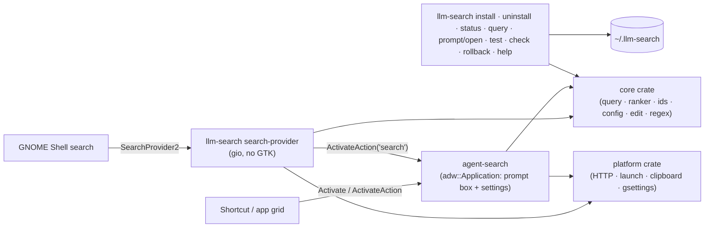
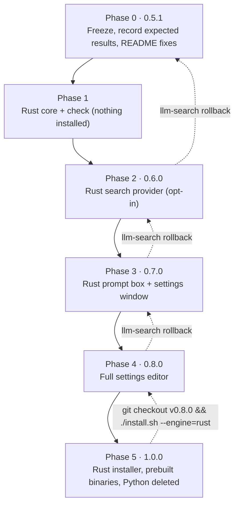

# Rust migration plan

> **Update (2026-10-18): the approach changed to a parallel build.** Instead of switching components
> in place one by one, the Rust version is built in full on the `rust` branch and installed **next to**
> the Python version under its own IDs (`io.github.oscillatingjem.AgentSearchRs`, shown as
> "Agent Search (Rust)", command `llm-search-rs`), using the same `~/.llm-search/config`. Both can be
> compared live. When the Rust build has proven itself, it takes over the real IDs and the Python code is
> deleted. The engine records, in-place switches and per-phase rollbacks below are therefore no longer
> needed. The rest still applies: matching recorded Python results, regex compatibility, comment-safe
> editing, `LLM_SEARCH_HOME` in Exec lines, and identical result ids.
>
> **Status:**
> - **Built:** the core (it matches all 577 recorded Python cases), the search provider, the prompt box,
>   the settings window (today's scope) and `rust/install-side-by-side.sh`.
> - **Full settings editor (Phase 4): built.**
>   - **Agents page:** every field of an agent, plus add, delete (with its comment block) and rename
>     (aliases follow the new id).
>   - **Routing page:** aliases, high-effort patterns and ranking rules, each with add, edit and delete.
>   - **Gateway:** the key name too.
>   - **Validation:** each save validates the whole config (it loads, ids are unique, every regex
>     compiles); patterns turn red while invalid.
>   - **Tests:** adding then deleting an agent or a rule restores the file byte for byte.
> - **Not built yet:** the Rust installer and prebuilt binaries.
> - **Measured:** the provider answers its first query in 29 ms (Python: 164 ms). Memory (PSS) is 4 MB for
>   the provider (Python: 18 MB) and 31 MB for the prompt box (Python: 51 MB).

The original lean plan follows for reference.

**Status:** you chose to rewrite in Rust at lean-and-safe rigor. This plan needs your sign-off before Phase 0.
**Date:** 2026-10-18 · **Estimate:** about 35–50 focused days, plus 3–7 days of everyday use after each switch.
**Review:** two independent checkers reviewed this plan against the full plan's critique and the behavior
spec, and all 27 of their findings are fixed below.
**Inputs:** [`docs/rust-plan/`](rust-plan/) holds:
- the behavior spec of the Python code (`parity-spec.json`, 134 behaviors);
- three competing plans with their judges' scores (`competing-plans.json`);
- the full-rigor draft and its critique.

Facts marked † were not confirmed when this plan was written; each is checked on the first day of the phase
that depends on it.

## 1. Summary

- **What changes:** Python and PyGObject are replaced by two Rust binaries, one component at a time.
- **New:** the settings window can edit everything in `agents.toml`.
- **What stays the same for users:**
  - the D-Bus names;
  - `~/.llm-search` and its files, comments included;
  - the shortcut and its gsettings path;
  - the search syntax and result ids;
  - the CLI commands;
  - the log lines.
- **How it stays safe:**
  - **Expected results recorded from Python 0.5.0.** Rust must reproduce them, and any difference is
    listed in `deviations.md` and approved by you.
  - **One component at a time,** behind the same D-Bus names.
  - **Rollback rehearsed in every phase.**
  - **A config backup** on every install and rollback.
  - **An installer that never touches a working install until the new build is verified.**
- **What's left out compared with the full plan:**
  - keeping Python running as a live reference;
  - million-case random comparisons;
  - multi-week test periods.

## 2. Target architecture

**Workspace:**
- Edition 2024, `rust-version = "1.92"`.
- `Cargo.lock` is committed, and every build uses `--locked`.

| Crate | Output | Links | Contents |
|---|---|---|---|
| `core` | library | no GTK or GLib | Query parsing, effort, ranking, result ids, alias resolution, URL and command templating, config loading, `secrets.env`, change signature, legacy migration, restore defaults, TOML editing, the Python-compatible regex layer, and gateway response parsing (`models_from_info`). Activation returns `Activation { copy: Option<String>, launch: Spawn{argv,cwd} \| OpenUri \| Nothing }` or an error; it runs nothing itself. |
| `platform` | library | glib, gio, soup3 | Gateway HTTP, the launch executor (copies to the clipboard first, then launches, and reports errors), clipboard via `wl-copy`/`xclip`, icon names, and the shortcut through `gio::Settings` |
| `cli` | `llm-search` | core, platform (no GTK) | The CLI and installer, and `search-provider` as a subcommand, which is dispatched before GLib sees argv |
| `ui` | `agent-search` | core, platform, gtk4, libadwaita | The prompt box, settings window and shortcut dialog |

**Why two binaries:**
- `llm-search` doesn't link GTK. On a machine without libadwaita it can still run `install`, `status` and
  `check` and print the right install hint.
- The search provider never loads GTK.

**Crates** (latest stable on 2026-10-18):
- `gtk4 0.11.5` with feature `v4_14`.
- `libadwaita 0.9.2` with feature `v1_5`, needed for AlertDialog.
- `gio`/`glib 0.22`.
- `soup3 0.9`: keeps `https` gateways working.
- `toml 1.1` with serde, and `toml_edit 0.25`.
- `fancy-regex 0.19`.
- `percent-encoding 2.3`: the set NON_ALPHANUMERIC minus `-._~` equals Python's `quote(safe='')`.
- `blake2 0.10`† using **`Blake2sVar::new(6)`**. The digest length goes in the BLAKE2 parameter block,
  exactly like Python's `blake2s(digest_size=6)`; truncating BLAKE2s-256 would change every id. Checked
  against the recorded Python ids on the first day of Phase 1.
- `serde_json`, and `libc` for `setsid`.

**Rejected:**
- `zbus 6.0`: just released with breaking changes, and it would open a second bus connection.
- The `search-provider` crate: it's pinned to zbus 5.

**D-Bus:** everything goes through gio, with one connection per process. The provider:
- is a `gio::Application` with a 60 s inactivity timeout;
- is started as `llm-search search-provider --gapplication-service`. The subcommand is removed before GLib
  parses argv, and `IS_SERVICE` is not hard-coded: the Rust facts warn that hard-coding it makes
  registration fail when an instance is already running. This differs from Python and is listed in
  `deviations.md`. A test checks that a second activation exits cleanly;
- registers the SearchProvider2 object in `dbus_register`, and holds the app until each call is answered;
- maps errors to `org.freedesktop.DBus.Error.Failed` or `UnknownMethod`;
- wraps handlers in `catch_unwind`, and clippy denies `unwrap` and `expect` outside tests.

The prompt box is an `adw::Application` that keeps GTK's default command-line handling, so
`--gapplication-service` keeps working.

**Regex:** your routing patterns are written for Python's `re`. They run on `fancy-regex`
(case-insensitive, `is_match` in place of `re.search`), with a small translator for differences that are
cheap to fix:
- `\Z` becomes `\z`, and an unanchored `$` becomes `(?=\n?\z)`.
- `{,n}` becomes `{0,n}`.
- `\s`/`\S` match Python's whitespace set.
- `&&`, `--` and `~~` inside a class, and a bare `{`, become literals.

Rust-only syntax is rejected with Python's error: `\p`, `\P`, `(?<name>`, `\K`, `\G`.
Remaining known difference: `\w` and `\b` on combining marks and characters like `²`. This is documented.
A compile error is kept per pattern and raised when that pattern is used, as in Python.
`llm-search check` compiles your patterns. Until Python is deleted, it also runs them through Python and
Rust and shows any mismatch with a suggested rewrite.

**Config loading:**
- `[[app]]` and `[[routing.rule]]` reject unknown keys and require `id`/`name` and `tag`/`patterns`, so
  they fail at load like Python. Other tables ignore unknown keys.
- Numeric fields accept an integer or a float.
- A wrongly typed value (say, `priority = "x"`) fails where Python fails it, when ranking, not at load.
  That way the settings window still opens to fix it.
- Errors report the line and column (see §3 Changed).
- **Through 1.0.x,** Rust rejects TOML 1.1-only syntax and writes TOML 1.0 only, so a rollback to 0.8.0
  can always read the config. This rule lifts at 1.1.

**Editing** (uses `toml_edit` and keeps today's rules):
- Comments are kept, and a changed value keeps its trailing comment.
- A missing key goes below its table header, or below `id` in an agent†.
- A missing table is appended as `[name]  # added by the settings window`.
- **Values are written as Python wrote them:**
  - TOML basic strings with `json.dumps` escaping (non-ASCII becomes `\uXXXX`);
  - floats use Python's `repr` (`30.0`, `1e+16`);
  - line endings become LF with one final newline.
- Astral characters (like emoji) are written raw. That fixes a Python EditError and is listed in
  `deviations.md`.
- **Every save re-reads the file from disk** and applies only the pending change, as today, so edits
  made in a text editor are never overwritten.
- Each write is checked by reloading the result, then saved atomically with the file mode kept.

**HTTP:**
- soup3 runs on the GLib main loop, with a 500 ms cancellable timeout that also bounds DNS lookups.
- A non-2xx reply counts as a failure (30 s back-off), as with urllib.
- The Bearer header is sent only when the key is set.
- The cache lasts 60 s. Its clock is `glib::monotonic_time` (time since boot), so early fetches behave as
  today, and it resets on config reload.
- In the prompt box, a generation counter drops rows from an earlier keystroke.

**Launching:**
- URIs open with `gio::AppInfo::launch_default_for_uri`.
- Commands run with `std::process::Command` and `setsid`; the GLib main loop cleans up finished child
  processes.

**Templates:** the installer's templates, icon and example config are embedded in the binary, so an
installed or prebuilt binary can reinstall without the repo.

## 3. Contracts

**Kept:**
- Bus names, object paths, the SearchProvider2 interface and its result fields.
- The `.ini`, `.service` and desktop file names, the icon, and the `--gapplication-service` activation of
  the prompt box.
- The result id format `<cid>|<model>|<effort>|<hash>`, with identical hashes.
- **Environment:**
  - `LLM_SEARCH_HOME`: empty means `~/.llm-search`, with no `~` expansion;
  - `XDG_DATA_HOME`, `XDG_CONFIG_HOME`, `HOME`;
  - `PATH` plus `~/.local/bin` and `~/bin` for `requires`;
  - `XDG_BIN_HOME` is still ignored.
- The `agents.toml` schema and its comments, and the `secrets.env` format.
- The gsettings path `/org/gnome/settings-daemon/plugins/media-keys/custom-keybindings/llm-search/` and the
  command `~/.local/bin/llm-search prompt`.
- **The CLI:**
  - commands: `install`, `uninstall [--purge] [--dry-run]`, `prompt` (and its `open` alias), `status`,
    `query`, `test`, `help`;
  - `install` options, including `--name` (and `--category-name`), `--shortcut` and `--dry-run`;
  - exit codes.
- The `environment.d` line.
- **Log lines:**
  - `llm-search: running <argv0> in <cwd>` and `llm-search: opening <url without query>`;
  - the prompt is never logged.

**Changed** (each is listed in `docs/rust-plan/deviations.md` and approved before its release):
- **`.service` Exec lines:**
  - `Exec=/usr/bin/env LLM_SEARCH_HOME=@HOME@ <engine>/llm-search search-provider --gapplication-service`
  - `Exec=/usr/bin/env LLM_SEARCH_HOME=@HOME@ <engine>/agent-search --gapplication-service`
  - `<engine>` is `$XDG_DATA_HOME/llm-search/engine/`, never `bin/`, so `--copy` installs keep working.
  - `PYTHON` and `PYTHONPATH` are no longer read or set, so spawned commands no longer inherit PYTHONPATH.
- **Stopping old processes** goes by bus name: the installer asks D-Bus for each name's PID and sends
  SIGTERM. This replaces the `pkill` patterns, which would match the new binaries' own names and the
  installer.
- **`llm-search prompt`** calls `Activate` (no text) or `ActivateAction('search')` (with text) directly
  over D-Bus, as `gapplication` does today, passing `XDG_ACTIVATION_TOKEN` and `DESKTOP_STARTUP_ID`. The
  fallback that ran without `gapplication` (and ignored TEXT) is removed.
- **New commands:** `check` (requirements and pattern preflight) and `rollback`.
- **`llm-search test`:**
  - From 1.0.0 it runs the same checks as `check`; the developer tests need the repo and use `cargo test`.
  - The example config's comment that mentions `python3 -c "import tomllib…"` becomes `llm-search check`.
- **Error text:** config errors in toasts and D-Bus replies show the Rust TOML parser's message, with line
  and column, instead of tomllib's.
- **Handler errors** log one line, `llm-search: <method> failed: <error>`, instead of a Python traceback.
- **Outside edits (0.8.0):** a *Reload / Keep editing* banner replaces the automatic reload and its toast.
- **Uninstall and `--copy`:**
  - `uninstall` also removes `engine/` and `engine.prev/`, and `--purge` also removes `state/backup/`.
  - From 1.0.0, `--copy` is accepted but does nothing, because `engine/` is always a copy.
- **Requirements:**
  - Building needs Rust 1.92+.
  - Running needs GTK 4.14+, libadwaita 1.5+ and libsoup 3. That means GNOME 46 or newer.

## 4. Phases

**Rules:**
- Until Python is deleted, Rust reproduces Python's behavior, except for approved deviations. Crash and
  hang fixes are allowed at any time.
- Each release is tagged (`v0.5.1` … `v1.0.0`), asking you before every push.

**Install engine records** (Phases 2–4, in the bash installer):
- `state/install/engine.json` records the engine of each component (provider and prompt box: `python` or
  `rust`) and the build version.
- The previous record is kept as `engine.prev.json`, together with its rendered `.service` and `.desktop`
  files and `engine.prev/`.
- It rotates only when the version or engine changes, so reinstalling to change `--name` or `--shortcut`
  never overwrites the last good build.
- **`llm-search rollback`:**
  - restores the previous record and re-renders each component's Exec line from it: Python Exec lines for
    a Python component, never a path to a binary that isn't there;
  - reloads the bus, stops both bus names by PID, and runs `status`;
  - refuses if any Exec target is missing;
  - lists the newest config backup taken before the version being rolled back, and offers to restore it.
- `install --engine=python` is always a complete rollback until 1.0.
- **Every `install` and `rollback`** copies `config/` to `state/backup/<version>-<time>/`, keeping file
  modes, before changing anything.

**Rollback rehearsal** (an exit criterion of Phases 2–5):
- after rolling back, the shortcut opens the prompt box;
- `llm-search query hello` returns rows;
- the prompt box opens its settings window;
- the config backup restores.

### Phase 0: Freeze and record (3–4 days)
- **Tag:** `v0.5.0`, after asking you before pushing.
- **README fixes (0.5.1):**
  - The minimum is GNOME 46 / libadwaita 1.5, so drop the GNOME 45, Fedora 39 and Debian 12 claims.
  - The Debian/Ubuntu install line needs `gir1.2-gtk-4.0 gir1.2-adw-1`.
  - The installer warns when the GTK or Adw typelibs are missing.
- **Expected results:** `tests/golden/record.py` runs on the pinned Python 3.14.8, recorded in
  `tests/golden/META`, and writes the results to `tests/golden/*.jsonl`.
  - **Core inputs:** a seeded set of queries, configs and edits, plus every example in the behavior spec.
  - **Core coverage:**
    - parsing and ranking (ids, titles, row text);
    - alias resolution, URL and command filling, activation;
    - config loading, `secrets.env`, TOML edits, migration and restore defaults;
    - `models_from_info` on recorded `/model/info` bodies.
  - **CLI and installer:** stdout, stderr, exit code and the resulting file tree for
    `install --dry-run`, `install`, `install --copy --shortcut X`, `uninstall`, `uninstall --purge`,
    `status` and `query`. Each runs in a temporary HOME with a fake `gsettings` and `gdbus`.
- **Rollback spike:** change a rendered Exec line, reload the bus, and confirm the next activation uses
  the new binary without a logout. Test on Fedora 44 (dbus-broker) and in a Debian 13 container
  (dbus-daemon).
- **You:** install the toolchain:
  `sudo dnf install rust cargo gcc pkgconf-pkg-config gtk4-devel libadwaita-devel glib2-devel libsoup3-devel dbus-daemon xorg-x11-server-Xvfb`.
- **Exit:**
  - The recorded results are byte-identical across two runs.
  - The rollback spike passes on both D-Bus daemons.

### Phase 1: Rust core (7–10 days)
- **Workspace:** the `core` and `platform` crates, plus a minimal `cli` with `llm-search check` (the
  `search-provider` subcommand is a stub).
- **Tests:**
  - The 35 Python tests are ported one-to-one.
  - Replaying the recorded core results in `cargo test`.
  - The regex translator.
- **CI:** fmt, clippy, and tests on stable Rust and 1.92.
- **Installed at the end:** unchanged (Python).
- **Exit:**
  - Every recorded core result matches, or is in `deviations.md` with a reason you approved.
  - `check` passes on your `agents.toml`.

### Phase 2: Rust search provider, 0.6.0 (5–7 days, then 3–7 days of use)
- **Provider:** `llm-search search-provider`, behind the same bus name.
- **Installer** (still the bash one):
  - `--engine=rust` runs `cargo build --release --locked` from the repo, verifies the build
    (`--version`), then copies it into `engine/`, with the engine records described above.
  - The bash `llm-search` passes `check` on to the Rust binary, and implements `rollback` itself.
- **Tests:** a D-Bus test suite (gio TestDBus) that runs against Python first, then unchanged against Rust.
  - It activates the provider through the **rendered `.service` Exec line**, with a non-default
    `LLM_SEARCH_HOME`.
  - **Result coverage:** ids, row fields, unknown ids, errors, LaunchSearch, and ActivateResult with a
    recording launcher.
  - **Error and lifecycle coverage:** a bad regex, the 60 s idle exit, and a second activation exiting
    cleanly.
  - **Config changes:** changing `agents.toml` or `secrets.env` between two searches changes the results.
    A `settings.toml` present at start is migrated.
  - **Gateway:** a local mock `/model/info` server checks the Authorization header, the 60 s cache, the
    30 s back-off after an error or non-2xx reply, and the cache reset after a reload.
- **Installed at the end:** GNOME search runs on Rust; the prompt box is still Python.
- **Exit:**
  - The suite passes.
  - The rollback rehearsal passes.
  - You've used it for 3–7 days with no problems.

### Phase 3: Rust prompt box and settings window, 0.7.0 (7–10 days, then 3–7 days of use)
- **Prompt box:** `agent-search` with the same behavior: keys, dismissing on focus loss, staying resident
  and idle quit, and the `search` and `preferences` actions.
- **Settings window:** a faithful port of today's window, with the same rows, toasts, Restore Defaults,
  live refresh and shortcut capture. `gio::Settings::sync()` runs before quitting.
- **Tests:**
  - Each settings action's resulting `agents.toml` is compared with the recorded Python output.
  - GTK tests run under a virtual display (`xvfb-run`, `GSK_RENDERER=cairo`).
  - **The shortcut**, tested against a memory gsettings backend with the GNOME schemas:
    - the path is added to `custom-keybindings` only after name, command and binding are written;
    - removing it keeps the order of the other entries;
    - `command` is `<HOME>/.local/bin/llm-search prompt`;
    - the key-capture rules are unchanged.
  - Startup time: target 150 ms or less (Python: about 280 ms).
- **Installed at the end:** all-Rust UI; the CLI and installer are still bash.
- **Exit:**
  - The tests pass and a manual checklist is done.
  - The rollback rehearsal passes, including a mixed-engine rollback.
  - You've used it for 3–7 days with no problems.

### Phase 4: Full settings editor, 0.8.0 (8–12 days, then 3–7 days of use)
The feature you asked for: the settings window edits **everything** in `agents.toml`.
- **Agents:**
  - add, duplicate, delete, rename (updating aliases that point at the agent) and reorder;
  - every field, including the command with its optional argument groups;
  - disabled agents stay editable.
- **Routing:** aliases, high-effort patterns, and ranking rules (tag, weight, patterns), with add, edit and
  delete.
- **Gateway:** all fields, including the key name.
- **Validation:** the whole config is validated before every save, and regex patterns are checked as you
  type.
- **Outside edits:** a *Reload / Keep editing* banner. *Keep editing* keeps the unsaved form contents but
  never writes back an old copy of the file. If the pending change no longer applies, the save is refused
  with a toast.
- **Tests:**
  - Applying an operation and then its inverse gives back the original bytes.
  - Each operation's diff touches only the intended lines.
  - Every config key has an editor.
  - Your real config survives 50 mixed edits with every comment intact.
- **Installed at the end:** the full editor. A config backup is taken before the upgrade.
- **Rollback:** `llm-search rollback` (back to 0.7.0), then optionally restore `state/backup/0.8.0-*`.
- **Exit:**
  - The tests pass and a manual checklist is done.
  - The rollback rehearsal passes.
  - You've used it for 3–7 days with no problems.

### Phase 5: Python-free 1.0.0 (5–7 days)
- **Rust CLI and installer:** same commands, options and messages.
- **Tests:** the Rust CLI reproduces the Phase 0 installer recordings. They include:
  - cleanup of the old `LlmSearchProvider` files;
  - the `environment.d` check, and removing the file when the check fails;
  - symlink handling;
  - dry-run output;
  - the uninstall and purge paths.
- **Upgrade safety:**
  1. `bin/llm-search` stays in the repo as a short POSIX-sh shim. It runs
     `$XDG_DATA_HOME/llm-search/engine/llm-search` if that exists; otherwise it prints "Agent Search
     needs reinstalling: run ./install.sh" with the requirements hint. So the shortcut's command never
     points at nothing.
  2. `install.sh` checks requirements and builds or verifies the new binary (`engine.new/llm-search
     --version`) **before** touching any link or rendered file. On failure it leaves the existing install
     untouched, and prints the rollback command.
  3. The README and release notes say the upgrade is `git pull && ./install.sh`, run together.
  4. `llm-search status` in the last 0.8.x release warns about this.
- **Prebuilt binaries:**
  - Built by GitHub Actions on a pinned `ubuntu-24.04` runner (glibc 2.39), with SHA256SUMS.
  - Releases start as drafts and are published only with your OK.
- **Python removal:** Python is deleted once both Rust components have been your default for at least 7
  days.
- **Rollback:**
  - The Rust installer creates the same six targets as **symlinks**, so the 0.8.0 bash installer can take
    them back.
  - In 1.0, `llm-search rollback` prints
    `git checkout v0.8.0 && ./install.sh --engine=rust` and exits non-zero.
- **Exit:**
  - The tests pass.
  - That rollback is rehearsed: afterwards the shortcut, `llm-search prompt`, GNOME search and the
    settings window all work.

## 5. Install from source

| Distro | Rust | Build packages |
|---|---|---|
| Fedora 43/44 | distro 1.99 | `rust cargo gcc pkgconf-pkg-config gtk4-devel libadwaita-devel glib2-devel libsoup3-devel` |
| Silverblue | in a Fedora toolbox | same, inside the toolbox; the binaries run on the host |
| Debian 13 | `trixie-backports` (1.96) or rustup | `build-essential pkg-config libgtk-4-dev libadwaita-1-dev libglib2.0-dev libsoup-3.0-dev`† |
| Ubuntu 24.04 | rustup (distro 1.91 is too old) | same as Debian |
| Ubuntu 26.04 | distro 1.93 | same as Debian |
| Arch | distro | `base-devel rust gtk4 libadwaita libsoup3`† |
| Tumbleweed | distro | `rust cargo gcc pkgconf-pkg-config gtk4-devel libadwaita-devel glib2-devel libsoup-devel`† |

- `https` gateways also need `glib-networking`, which comes with GNOME desktops.
- Running the tests also needs `dbus-daemon` and Xvfb (`xvfb-run`, `GSK_RENDERER=cairo`).

## 6. Risks

| Risk | Mitigation |
|---|---|
| Regex patterns behave differently | Translator, `check` on your patterns, documented differences; fallback engine `glib::Regex` |
| Reload without logout fails on some D-Bus daemon | Phase 0 spike on both daemons; fallback: rename and re-link the rendered file |
| A rollback leaves a broken half-install | Per-component engine records, refusal when an Exec target is missing, rehearsal in every phase |
| Upgrade to 1.0 breaks before `./install.sh` runs | The `bin/llm-search` shim, and an installer that verifies the build before switching |
| Rust writes a config Python can't read | TOML 1.0 output only through 1.0.x, config backups, results compared with Python's |
| `toml_edit` moves comments when adding or deleting entries | Explicit placement, inverse-operation and diff tests, your config as a test case |
| A panic kills the process | `catch_unwind` at handler boundaries, no `unwrap`, errors become toasts or D-Bus errors |
| Distro Rust too old | Prebuilt binaries, documented rustup/backports paths, CI job on Rust 1.92 |
| gtk-rs API churn | `--locked` builds, one planned upgrade per GNOME release |

## 7. Decisions before Phase 0 (recommended defaults)

1. **Two binaries** (GTK-free `llm-search`, adw `agent-search`). *Yes.*
2. **HTTP via soup3**, which keeps `https` gateways working. *Yes.*
3. **Regex via fancy-regex** with the translator. *Yes;* `glib::Regex` is the fallback.
4. **New keys go below the table header or `id` line** (as today). *Keep.*
5. **Settings save model:** single values save instantly, compound edits (a new agent, a rule) have an
   Apply button. *Yes.*
6. **Real-use time:** 3–7 days after each switch, and 7 days before Python is deleted. *Yes.*
7. **Other users:** the Rust engine is opt-in (`--engine=rust`) until 1.0.0. *Yes.*
8. **Prebuilt binaries:** x86_64 only for now. Every push, tag and release is asked first. *Yes.*
