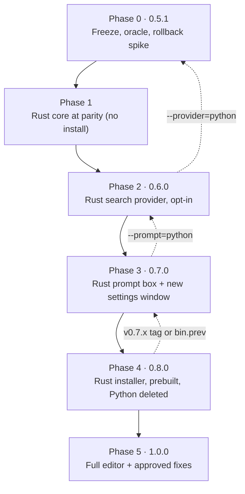

# Agent Search: Rust migration plan

**Status:** draft for owner approval, 2026-10-18. Target file: `docs/RUST-MIGRATION.md`.
**Marker:** † means the fact has not been checked yet. Each † item is checked on day one of the phase that first relies on it.

## 1. Summary

- **What changes.** Python 3.11 and PyGObject are replaced by two Rust binaries:
  - `llm-search` is GTK-free. It holds the CLI, the installer and the GNOME search provider.
  - `agent-search` uses libadwaita. It holds the prompt box and the settings window.
- **New in the settings window.** It will be able to edit everything in `agents.toml`.
- **What stays the same for users.**
  - The GNOME search category and its position in Settings → Search.
  - The keyboard shortcut and `~/.local/bin/llm-search prompt`.
  - `~/.llm-search/config` and all the comments in it.
  - The search syntax, result rows and ids, and the CLI verbs.
- **How it is done.**
  - Python 0.5.0 is frozen and kept running as a reference ("oracle").
  - Components switch one at a time behind unchanged D-Bus names.
  - Every switch can be reversed in seconds without logging out (Phase 0 proves this).
  - No behavior fix ships in the same release as a switch.
- **Estimate.** 65–90 focused days plus about 3 weeks of daily-use testing ("soak"). That is roughly 4–6 calendar months part-time. Version 1.0 ships at the end of Phase 5.

## 2. Target architecture

**Workspace.** Edition 2024, `rust-version = "1.92"`, `Cargo.lock` committed, every build uses `--locked`.

| Crate | Output | Links | Contents |
|---|---|---|---|
| `core` | lib `agent_search_core` | no GTK or GLib (a CI grep enforces this) | `query`, `ranker`, `ids`, `catalog`, `resolve`, `urlfill`, `command`, `which` (injectable), `config`, `secrets`, `signature`, `migrate`, `edit`, `pyre`, `pycompat`. Activation returns `Action {Copy, Spawn{argv,cwd}, OpenUri, Nothing}` and never runs anything itself. |
| `cli` | bin `llm-search` | glib, gio, soup3 | The CLI and installer, plus a hidden `search-provider` mode |
| `ui` | bin `agent-search` | gtk4, libadwaita | Prompt box, settings window, shortcut dialog |
| `parity` | bin `agent-search-parity`, never installed | core, serde_json | Speaks the same JSONL protocol as `tests/parity/oracle.py` |

**Why the binaries are split.** A Rust binary linked against GTK fails to start on a machine without libadwaita, because Rust links with BIND_NOW (likely, not confirmed). Keeping `llm-search` free of GTK means:
- `install`, `status` and `check` can still run on such a machine and print the right distro hint.
- The search provider never loads GTK, which keeps its start time low.

**Crates.** All versions below were checked as the latest stable on 2026-10-18.

| Purpose | Crate | Notes |
|---|---|---|
| UI | `gtk4 0.11.5`, feature `v4_14` | `v4_12` is the hard floor; `v4_14` matches Ubuntu 24.04 |
| UI | `libadwaita 0.9.2`, feature `v1_5` | Needed for AlertDialog. NavigationView and SpinRow are 1.4. Version 0.9.0 is yanked. |
| GLib | `glib`, `gio 0.22.10` | MSRV 1.92 |
| HTTP | `soup3 0.9.0` | Async on the GLib main loop; https works through glib-networking |
| Config | `toml 1.1.8` + `serde 1` (derive); `toml_edit 0.25.17` | Both MSRV 1.85 |
| Regex | `fancy-regex 0.19.2` | Pulls in `regex 1.13.1` |
| URL encoding | `percent-encoding 2.3.2` | Set: NON_ALPHANUMERIC minus `-._~`. This equals Python's `quote(safe='')`. |
| IDs | `blake2` (`Blake2sVar::new(6)`) | Version 0.10.x†. Pinned once the six ID-01 vectors pass. |
| Misc | `serde_json 1`, `libc 0.2`† | libc is needed for `setsid` |

Rejected:
- `zbus 6.0.0`: released two days ago with breaking changes, and it opens a second bus connection.
- `search-provider 0.13.0`: pinned to zbus 5, needs a second bus name, and calls `unwrap()` on the session connection.

**D-Bus.** Everything goes through gio, with one connection per process.
- The provider is a `gio::Application` with id `io.github.oscillatingjem.AgentSearch.SearchProvider`, `IS_SERVICE`, and a 60000 ms inactivity timeout.
- `ApplicationImpl::dbus_register` chains up, then calls `register_object(path, iface)`. The interface is built from the existing `INTERFACE_XML` using `typed_method_call(...).invoke_and_return_future_local`.
- Each call holds `app.hold()` until it is answered.
- Errors map to `org.freedesktop.DBus.Error.Failed` or `UnknownMethod`. `catch_unwind` wraps every handler, and clippy denies `unwrap` and `expect` outside tests.
- Calls are answered in arrival order. The stored rows are replaced only when a reply is sent.
- The prompt box is an `adw::Application` with default flags. It never overrides `local_command_line`, so `--gapplication-service` keeps working.

**Regex.** Patterns use `RegexBuilder::new(p).case_insensitive(true).backtrack_limit(…)`, and `is_match` stands in for `re.search`. A small translator handles the Python differences that are cheap to fix:
- `\Z` becomes `\z`.
- An unanchored `$` becomes `(?=\n?\z)`.
- `{,n}` becomes `{0,n}`.
- `\<` and `\>` become literals.
- A bare `[` inside a class is escaped.
- `\s` becomes `[\s\x1c-\x1f]`.

Rejected with a clear message: `\N{NAME}`, octal escapes, `(?a)`, `(?L)`, and global flags in the middle of a pattern.

Known differences that remain, and are documented:
- `\w` and `\b` treat combining marks and characters like `²` and `Ⅻ` differently from Python.
- Case folding of `İ` and `ı` differs†.
- Hitting the backtrack limit counts as "no match" and is logged.

How existing patterns are handled:
- Patterns are compiled once at load. A compile error is stored per pattern and raised when that pattern is reached, as Python does today.
- Before an engine switch, a preflight runs the user's own patterns through Python and Rust over a prompt corpus. Any difference blocks the switch and is listed with a suggested rewrite.

**Config loading.** Serde structs mirror the Python dataclasses.
- `deny_unknown_fields` applies only to `[[app]]` and `[[routing.rule]]`, as today.
- `priority`, `weight`, `idle_minutes`, `min_chars` and `max_rows` accept an int or a float.
- During parity, Python's quirks are reproduced: a string `"false"` counts as true, and a string where a list is expected behaves as Python does. `llm-search check` reports these as warnings.
- Errors carry a path and the line and column, using `toml::de::Error::span`. The exact text differs from tomllib's (an allowlisted difference, class B).

**Editing.** All edits go through `toml_edit::DocumentMut`.
- `edit::scalar` reproduces today's rules:
  - A replaced value keeps its indentation, separator and trailing comment.
  - A missing key goes directly below the table header or the `id` line, not at the end of the table as `toml_edit` would do by default.
  - A missing table is added as `[t]  # added by the settings window`.
  - Every value is read back with Python's numeric leniency, and the EditError texts are unchanged.
  - Floats are written as Python `repr` writes them (`30.0`); toml_edit's own formatting is unconfirmed†.
- Writes go to a temp file in the same directory, keep the old mode, fsync, then rename.
- `edit::structure` (Phase 5) adds structural changes. It uses `push_formatted` with copied decor and never calls `Array::fmt()` on existing arrays.

**HTTP.** soup3 with a `gio::Cancellable` and a 500 ms glib timeout, because soup Session timeouts are in whole seconds†. The cancellable also bounds DNS lookups.

The gateway cache start is reproduced exactly: the clock is `glib::monotonic_time`, which counts from boot, and `fetched` and `failed` start at 0. It is never "process start", which would hide gateway rows for the provider's whole life.

**Launching.**
- URIs open with `gio::AppInfo::launch_default_for_uri`.
- Commands run with `std::process::Command`, `Stdio::null()`, and `unsafe pre_exec(libc::setsid)` (std's `CommandExt::setsid` is still nightly-only). Children are reaped with `glib::child_watch_add`.
- The clipboard still uses `wl-copy --`, or `xclip -selection clipboard`.

## 3. Contracts

**Kept:**
- Bus names, object paths, the SearchProvider2 XML, the meta keys and the error names.
- The `.ini` file, the `.service` file names, the desktop id, the icon and the Wayland app_id.
- Result id format `<cid>|<model>|<effort>|<blake2s-48>`, with identical hashes.
- Title, subtitle and description formats.
- `LLM_SEARCH_HOME` semantics and the `~/.llm-search` layout.
- The `agents.toml` schema and comment preservation. Until 1.0, files are written only in TOML 1.0 and no new keys are added.
- The `secrets.env` format and the gateway HTTP contract.
- The gsettings path `/org/gnome/settings-daemon/plugins/media-keys/custom-keybindings/llm-search/` and the command `<HOME>/.local/bin/llm-search prompt`.
- The CLI verbs, options and exit codes 0/1/2.
- The `environment.d` line, so existing installs print "keeping".
- The `llm-search: ` log prefix.

**Changed:**

| Change | Phase | Migration |
|---|---|---|
| `.service` Exec lines point at the Rust binaries in `$XDG_DATA_HOME/llm-search/bin/`; PYTHONPATH is dropped | 2, 3 | Re-run `./install.sh`; no logout needed |
| Temporary `--provider` / `--prompt` engine flags and `llm-search rollback` | 2–4 | Flags removed in 0.8 |
| Process names become `llm-search search-provider` and `agent-search` | 2, 3 | The installer stops both generations; TROUBLESHOOTING updated |
| `~/.local/bin/llm-search` links to the installed binary; `--copy` does nothing; `uninstall` removes the binaries | 4 | Re-run `./install.sh` |
| `llm-search test` becomes an alias of the new `check`; new `restart`; extra `status` lines; dry-run prints "would remove" | 4 | None |
| Requirements: Rust 1.92+ (to build) or the prebuilt tarball; GTK 4.14, libadwaita 1.5, libsoup3 | 2 | README |
| Writer bytes: UTF-8 instead of `\uXXXX` (emoji values now save), CRLF kept, secrets file is 0600 from creation | 1 | None; tomllib reads the result the same way |
| URL templates: format specs, conversions and attribute access are rejected | 1 | The preflight flags any use |
| Settings window: new structure (3), full editor (5) | 3, 5 | None |

## 4. Phases

**Phase rule.** While any Python component can still run, Rust must match Python exactly. The only exceptions are crash and hang fixes: async gateway, no panics, process reaping, and the idle-timer race. Anything that changes rows, ids, launches or file contents waits for Phase 5.

### Phase 0: Freeze and baseline (5–7 days)

- **Goal:** make 0.5.0 the executable reference, prove the rollback method, and fix the docs.
- **Deliverables:**
  - Tag `v0.5.0` (pushed only with your approval).
  - `oracle.py`: a JSONL operation server, run with `python3 -I`, with `which`, the clock, HTTP, spawn, clipboard and URI opening replaced by stubs.
  - A seeded corpus generator and `golden/*.jsonl`, including every verified vector from the parity spec.
  - `gen_unicode_tables.py`.
  - About 45 new Python tests for the spec's coverage gaps.
  - A golden of the bash installer's output, taken in a Fedora 44 container.
  - An audit of your patterns, run read-only.
  - A benchmark script.
  - README and doc fixes (§6).
  - `check_requirements` also checks the Gtk 4 and Adw typelibs.
- **Rollback spike:** on Fedora 44 (dbus-broker), rewrite a rendered Exec line, call `org.freedesktop.DBus.ReloadConfig`, kill the process, and confirm the next activation uses the new Exec without a logout†.
- **Installed at the end:** Python 0.5.1, same behavior.
- **Proof:** the oracle reproduces every test assertion, and goldens are byte-identical across two runs.
- **Exit:** all tests green; a coverage report shows every spec ID; the spike passes, or the fallback (rename and re-link the rendered file) is proven.
- **Rollback:** revert the commit.

### Phase 1: Core at parity (13–18 days)

- **Deliverables:**
  - The workspace and CI: pinned `ubuntu-24.04`, fmt, clippy, stable and 1.92 jobs, a Fedora 44 container job, and the Python tests.
  - All core modules and `edit::scalar`.
  - The 35 tests ported one to one with the same names, plus the Phase 0 additions.
  - The parity binary.
- **Installed at the end:** unchanged (Python 0.5.1).
- **Proof (§5):**
  - Golden replay passes 100%.
  - At least 1M live differential cases for queries and configs, and at least 50k for edits.
  - Exhaustive per-code-point checks.
  - The cross-readability gate.
- **Exit:** zero differences that are not allowlisted; you have reviewed `deviations.toml`.
- **Rollback:** nothing is installed.

### Phase 2: Rust search provider, 0.6.0 (8–10 days, then a 7-day soak)

- **Deliverables:**
  - `search-provider` mode, matching DB-01..14 exactly.
  - The bash installer gains `--provider=rust|python`. It copies the binary, keeps the previous one as `.prev`, renders the Exec line, reloads the bus, and stops both generations of processes.
  - `llm-search rollback`.
  - The preflight refuses the switch on any difference (`--force` overrides).
- **Installed at the end:** GNOME search runs on Rust; the prompt box is still Python.
- **Proof:**
  - A gio::TestDBus suite runs first against Python, then unchanged against Rust. It covers ids, metas, unknown ids, error names, LaunchSearch to a fake prompt box, ActivateResult with a recording launcher, a bad regex, the 60 s idle exit, and overlapping async calls.
  - A manual check of 20 reference queries on GNOME 50.
- **Exit:**
  - The suite is clean.
  - Cold start is at or below the Python baseline.
  - The soak shows no differences or crashes.
  - Rollback has been rehearsed three times, each under 5 s.
- **Rollback:** `llm-search install --provider=python`.

### Phase 3: Rust prompt box and new settings window, 0.7.0 (12–17 days, then a 7-day soak)

- **Prompt box:** `agent-search` matching PB-01..18.
- **Settings window:** the old window is not ported. The final structure (ToolbarView, ViewStack, NavigationView subpages) is built once, with today's scope:
  - General: shortcut, idle time, results, files, Restore Defaults.
  - Agents: enable, priority, cwd.
  - Gateway: URL, chat URL, auto model, key, Test.
  - The shortcut dialog keeps the same capture rules.
- Strings and toasts are unchanged, and all writes go through `edit::scalar`.
- The installer gains `--prompt=rust|python`.
- **Installed at the end:** the Rust prompt box. All four provider/prompt-box engine combinations are supported.
- **Proof:**
  - Each settings action's resulting `agents.toml` is compared with the oracle's output for the same edit.
  - `#[gtk::test]` under `xvfb-run` with `GSK_RENDERER=cairo`.
  - TestDBus checks for the `search` and `preferences` actions.
  - A side-by-side manual checklist.
- **Exit:** cold start ≤150 ms; memory at or below Python's; the soak passes; rollback rehearsed for each combination.
- **Rollback:** `--prompt=python`. The cross-readability gate guarantees Python can read anything Rust wrote.

### Phase 4: Python-free 0.8.0 (9–12 days)

- **Deliverables:**
  - The Rust CLI and installer, with the same messages as CLI-01..24.
  - `prompt` calls `ActivateAction` with platform data built from `XDG_ACTIVATION_TOKEN` and `DESKTOP_STARTUP_ID`.
  - The shortcut is set through `gio::Settings`, with a schema check first and `sync()` before exit.
  - `check` and `restart`.
  - The `install.sh` bootstrap, the release workflow, and docs.
- **Deleting Python:** `src/llm_search`, the Python tests and the bash CLI are deleted only after both components have been the default on your machine for at least 14 days with no open parity issues.
- **Installed at the end:** Rust only.
- **Proof:**
  - The installer output matches the Phase 0 golden, except the Exec lines and the documented messages.
  - An upgrade from a real 0.5.0 install in a container keeps `agents.toml`, `secrets.env` and the shortcut byte for byte, and the old processes are stopped.
  - The distro smoke matrix passes.
- **Rollback:** `llm-search rollback` (back to `bin.prev`), or `git checkout v0.7.x && ./install.sh`. That works because the symlinks stay symlinks, so the bash installer can take them back.

### Phase 5: Full editor and fixes, 1.0.0 (18–26 days)

- **Editor:**
  - Structural operations: add, duplicate, delete, rename and reorder agents; arrays; the command argv with optional groups; aliases; routing rules; `key_env`.
  - The whole config is validated before every write.
  - Disabled agents can be edited.
  - A banner offers Reload or Keep editing when the file changes on disk.
- **Fixes:** the approved class C fixes, one commit each, each changing its golden.
- **Proof:**
  - Applying an operation and then its inverse gives back the original bytes.
  - Each operation's diff touches only the intended lines.
  - A schema-coverage test lists every key.
  - Random operation sequences pass both the Rust validator and tomllib plus v0.7.x `config.load`.
  - Your real config survives 50 mixed edits with all comments intact.
- **Rollback:** the previous release. The TOML-1.0 and no-new-keys rule lifts at 1.0.

## 5. Parity harness

- **Oracle:** `oracle.py` runs over the frozen `src/llm_search` and speaks the same JSONL protocol as `agent-search-parity`.
  - Operations: parse, rank (ids, titles, metas), resolve, URL fill, command fill, activate (returns an Action), load, read_env, set_secret, toml_apply, migrate, restore_defaults, re_search.
- **Goldens:** about 20k frozen cases, replayed in CI on every push and kept after Python is gone.
- **Live differential:** `run.sh` uses fresh seeds; it must show zero differences outside the allowlist.
- **Allowlist:** `deviations.toml` keys each entry by spec ID with a class: A (match exactly), B (deliberate difference), C (bug kept for now, fixed in Phase 5). It is reviewed by you.
- **Unicode:** every code point is checked for split, strip, splitlines, capitalize and lower, plus single-character probes of `\w`, `\s`, `\d` and `\b`.
- **Cross-readability:** every Rust-written file must parse with tomllib and load in Python with the same values.
- **D-Bus and installer suites:** as described in Phases 2–4.
- **After Phase 4:** the oracle is archived at the `v0.7.x` tag.

## 6. Install and distribution

Building from source needs Rust 1.92 or newer, a C linker, pkg-config, and the GTK 4, libadwaita, GLib and libsoup 3 dev files.

| Distro | Toolchain | Packages |
|---|---|---|
| Fedora 43/44 | distro rust 1.99 | `rust cargo gcc pkgconf-pkg-config gtk4-devel libadwaita-devel glib2-devel libsoup3-devel` |
| Silverblue/Kinoite | Fedora toolbox of the same release | Fedora list inside the toolbox. The binaries run on the host. |
| Debian 13 | `apt install -t trixie-backports rustc cargo` (1.96.1) or rustup; stable 1.85.1 is too old | `build-essential pkg-config libgtk-4-dev libadwaita-1-dev libglib2.0-dev libsoup-3.0-dev`† |
| Ubuntu 24.04 | rustup (newest distro rustc is 1.91) | same as Debian |
| Ubuntu 26.04 | distro rustc 1.93.1 | same as Debian |
| Arch | distro rust 1.99.1 | `base-devel pkgconf rust gtk4 libadwaita libsoup3`† |
| Tumbleweed | distro rust 1.99 | `rust cargo gcc pkgconf-pkg-config gtk4-devel libadwaita-devel glib2-devel libsoup-devel`† |

To run the tests, also install dbus-daemon and Xvfb (openSUSE package names†).

**Prebuilt binaries (Phase 4 onward):**
- Built on pinned `runs-on: ubuntu-24.04`, never `ubuntu-latest`, which moves to 26.04 between 2026-10-19 and 2026-11-19. Features are `v4_14` / `v1_5`, with dynamic linking.
- CI fails if the binary needs any glibc symbol newer than 2.39.
- A container smoke matrix runs `--version` and the TestDBus provider test on Fedora 43/44, Debian 13, Ubuntu 24.04/26.04, Arch and Tumbleweed.
- Releases are drafts, with SHA256SUMS and an attestation. Nothing is published without your approval.

**`install.sh` flow:**
1. If `bin/llm-search` sits next to it, run it. Otherwise check for cargo ≥1.92 and the pkg-config modules (`gtk4` ≥4.14, `libadwaita-1` ≥1.5, `libsoup-3.0`), print the per-distro hint for anything missing, and run `cargo build --release --locked`.
2. `llm-search install` then:
   - seeds the config without overwriting;
   - runs the legacy cleanup;
   - copies the binaries atomically;
   - renders the templates with Desktop Entry escaping;
   - creates the same six symlinks;
   - writes `environment.d` (the check accepts `/usr/share` with or without a trailing slash);
   - sets the shortcut;
   - stops both generations of processes;
   - runs `update-desktop-database` and prints the same "Done" text.

A logout is needed only on a first install.

**Minimum versions:** GNOME 46+ (GTK 4.14, libadwaita 1.5), glibc 2.39 for the prebuilt binaries, Fedora 43+, Debian 13+, Ubuntu 24.04+, Arch, Tumbleweed.

**README corrections (in 0.5.1):**
- Drop the GNOME 45, Fedora 39 and Debian 12 claims (Debian 12 ships libadwaita 1.2).
- Debian/Ubuntu install line: `python3-gi gir1.2-glib-2.0 gir1.2-gtk-4.0 gir1.2-adw-1 wl-clipboard`.
- USAGE: the category icon opens the prompt box.
- TROUBLESHOOTING: the config reloads when the files change, and the id format is the current one.
- CONFIGURATION: "two files", not three.

## 7. Risks and mitigations

- **Regex drift.** Mitigations: the translator, per-character probes, the preflight on your patterns, and a backtrack limit. Fallback: `glib::Regex` (PCRE2).
- **The rollback method fails on dbus-broker.** Mitigation: the Phase 0 spike, with rename and re-link as the fallback.
- **Rust writes something Python can't read.** Mitigations: the cross-readability gate, TOML 1.0 output only, and the schema freeze until 1.0.
- **toml_edit decor pitfalls** (multi-line arrays collapsing, comments moving with deleted entries). Mitigations: explicit key placement, round-trip and inverse tests, and you review diffs of your own config.
- **A panic aborts the process** (PyGObject only printed errors). Mitigations: `catch_unwind` at handler boundaries, clippy lints against `unwrap`/`expect`, and every error mapped to a toast or a Failed reply.
- **Distro rustc too old** (Ubuntu 24.04, Debian 13). Mitigations: prebuilt tarballs, documented rustup and backports paths, and an MSRV CI job.
- **Raising a feature flag drops distros** (BIND_NOW). Mitigations: fixed flags, the pinned runner, and the smoke matrix.
- **gtk-rs churn** (0.11.x patches have reverted APIs; 0.12/0.23 is coming). Mitigations: `--locked` builds and one planned upgrade per GNOME cycle.
- **One maintainer, a long plan.** Mitigations: every phase ships something useful or a proof on its own, and the project can pause safely after Phase 2.

## 8. Decisions needed before Phase 0

1. **Binary split:** two binaries, a GTK-free `llm-search` and an adw `agent-search`. *Recommended: yes.*
2. **HTTP client:** soup3, which keeps https gateways working. The alternative is ureq 3.4.2 with rustls; plain HTTP only is ruled out. *Recommended: soup3.*
3. **Regex engine:** fancy-regex plus the small translator and preflight, or glib::Regex. *Recommended: fancy-regex.*
4. **Placement of missing keys:** keep "below the header or id line", or switch to toml_edit's "end of table". *Recommended: keep.*
5. **Editor save model:** instant save for single values, explicit Apply for compound edits. *Recommended: yes.*
6. **Soak lengths:** 7 days per switch, 14 days before Python is deleted. *Recommended: yes.*
7. **Phase 5 fixes:** approve the robustness fixes as a group; review the behavior changes one by one. Robustness: skip-and-report invalid regexes, keep the last good config, write through a symlinked `agents.toml`, pass the activation token, fetch from the gateway in the first 60 s. Behavior: `max_rows` = 1, `app:` alias targets, `requires` substitution, URL literal normalization. *Recommended: this split.*
8. **Prebuilt targets and pushes:** x86_64 only for now, and I ask before every push, tag and release. *Recommended: yes.*